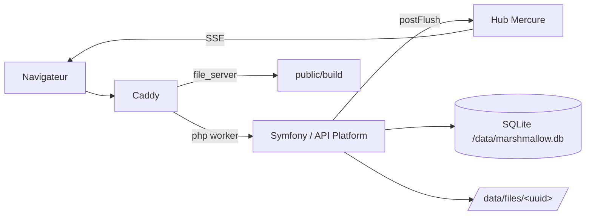

# Marshmallow

Un presse-papier partagé entre navigateurs, plus le dernier fichier uploadé. Chaque poste voit le texte taper en direct chez les autres et récupère le dernier fichier déposé.

## Fonctionnement

Une seule image Docker (FrankenPHP : Caddy + PHP 8.5 en worker mode) sert tout :

- l'API Symfony 8.1 / API Platform 5 sous `/api/*`, état dans SQLite ;
- le hub Mercure intégré sous `/.well-known/mercure` ;
- la page `/`, rendue par Symfony (Twig + Symfony UX Vue), qui passe l'état initial au composant Vue ;
- les bundles Vite sous `/build/*`.



La page arrive déjà avec le texte et le dernier fichier (props `initialText`, `initialLatestFile`, `limits`), donc pas de chargement intermédiaire. Le client s'abonne ensuite au hub et resynchronise à chaque ouverture de connexion, la première comprise : le hub n'a pas d'historique, ce refetch est ce qui réaligne l'état.

L'état persistant vit dans `/data` (volume) : base SQLite, fichiers, uploads temporaires. Les certificats Caddy sont dans `/config`.

## Stack

Symfony 8.1, API Platform 5, Doctrine ORM 3 sur SQLite, Mercure, Twig, Vue 3 + TypeScript (Vite, Symfony UX Vue), FrankenPHP, Bun.

## Développement

```sh
make up                            # page + API + hub sur http://localhost:8080
bun install && bun run dev         # serveur Vite sur l'hôte, à ouvrir via http://localhost:8080
```

- La page est toujours servie par `:8080`. Sans serveur Vite, c'est le build dans `public/build/` qui est utilisé ; le fichier `public/build/.vite/entrypoints.json` est obligatoire, sans quoi la page renvoie une 500.
- En dev, `pentatrion/vite-bundle` relit `entrypoints.json` à chaque rendu : on peut démarrer ou arrêter Vite sans redémarrer les workers.
- Pas de CSP en dev (le HMR et les styles inline du serveur Vite passeraient pas) ; elle est posée en prod et en test.

Les commandes PHP passent par le conteneur (`docker compose run --rm app bin/phpunit`), les commandes front tournent sur l'hôte (`bun run test`, `bun run typecheck`, `bun run lint`, `bun run build`).

### Contrat d'API

`make contract` exporte l'OpenAPI vers `assets/api/generated/openapi.json` et régénère `schema.d.ts` ; les deux fichiers sont versionnés. Pour vérifier qu'ils ne dérivent pas :

```sh
make contract && git diff --exit-code assets/api/generated
```

## API

| Méthode | Chemin | Note |
|---|---|---|
| GET | `/api/text` | `{content, version, updatedAt}` |
| PUT | `/api/text` | `{content, baseVersion}` ; 409 si `baseVersion` est périmé |
| GET | `/api/files/latest` | 0 ou 1 fichier |
| GET | `/api/files/{id}` | métadonnées du fichier |
| POST | `/api/files` | multipart, champ `file` |
| GET | `/api/files/{id}/content` | contenu, `Range` accepté |

Les erreurs sortent en `application/problem+json`, avec le code métier dans `type` (`urn:marshmallow:error:<CODE>`).

## Production

```sh
make build-prod   # image marshmallow:prod
make smoke        # build + test de fumée sur http://localhost:18081
SERVER_NAME=marshmallow.example.com APP_SECRET=$(openssl rand -hex 32) make up-prod
```

- Le stage `web_build` du `Dockerfile` construit le front (`bun run build`) et le copie dans l'image, sans les sources JS ni l'outillage.
- `compose.prod.yaml` utilise le projet `marshmallow-prod`, distinct de la stack de dev, avec les volumes `marshmallow_data` (`/data`) et `caddy_config` (`/config`).
- `SERVER_NAME` peut être un domaine (HTTPS automatique Let's Encrypt) ou `:80` derrière un reverse proxy TLS.
- **Derrière un reverse proxy TLS, `TRUSTED_PROXIES` est obligatoire** : IP ou CIDR du proxy, séparés par des virgules (`private_ranges` et `REMOTE_ADDR` sont acceptés). Sinon Symfony voit `http://` alors que le navigateur envoie `Origin: https://…`, et tous les `POST`/`PUT` reçoivent un 403. Le proxy doit aussi transmettre `X-Forwarded-Proto` (et `X-Forwarded-Host`/`X-Forwarded-Port` s'il réécrit l'hôte ou le port).
- **DNS rebinding** : avec `SERVER_NAME=:80`, Caddy accepte n'importe quel `Host`. `TRUSTED_HOSTS` (regex séparées par des virgules, par exemple `^marshmallow\.example\.com$`) filtre les autres, qui reçoivent un 400. Avec un `SERVER_NAME` nommé, Caddy filtre déjà l'hôte.
- `HTTP_PORT` et `HTTPS_PORT` (80/443 par défaut) changent les ports publiés.
- L'image tourne en `www-data` (uid 33) ; pour un bind mount à la place du volume nommé, un `chown -R 33:33` côté hôte.
- Healthcheck : endpoint `/metrics` de l'admin Caddy (`localhost:2019`, interne au conteneur).
- Les migrations Doctrine sont jouées au démarrage par l'entrypoint.
- `scripts/smoke.sh` accepte `PORT`, `IMAGE` et `BUILD=1`.

`APP_SECRET`, `SERVER_NAME`, `TRUSTED_PROXIES` et `TRUSTED_HOSTS` viennent du compose ; `APP_ENV`, `DATABASE_URL` et `FILES_DIR` sont fixés dans l'image. `FILES_STORAGE_DSN`, optionnelle, prend le pas sur `FILES_DIR`.

> Avant un build de prod, nettoyer les fichiers dotenv de la racine : `composer dump-env prod` compile leurs valeurs dans l'image, restes de recettes Flex compris. Seules `APP_SECRET` (vide), `DATABASE_URL` (SQLite), `DEFAULT_URI` et éventuellement `FILES_DIR` sont utiles ; `MERCURE_URL`, `MERCURE_PUBLIC_URL`, `MERCURE_JWT_SECRET` et la variante Postgres de `DATABASE_URL` sont à retirer.

## Sécurité

- HTTPS requis pour le presse-papier : `navigator.clipboard.readText()` n'existe que dans un contexte sécurisé (HTTPS ou `localhost`).
- Pas d'authentification : quiconque atteint l'URL lit et écrit. À n'exposer que sur un réseau de confiance, ou derrière une authentification en amont.
- Écritures `/api/*` : contrôle same-origin (`Origin` / `Sec-Fetch-Site`) contre le CSRF.
- Téléchargements : MIME détecté côté serveur, `nosniff`, `Content-Security-Policy: default-src 'none'; sandbox`. Seules les images raster (png, jpeg, gif, webp) sont servies `inline`, tout le reste (SVG, HTML compris) en `attachment` et `application/octet-stream`.
- Page : CSP stricte posée par Symfony (`script-src 'self'`, Google Fonts autorisé pour la police, `connect-src 'self'`), `X-Frame-Options: DENY` posé par Caddy, `Permissions-Policy` restrictive (le presse-papier reste autorisé), HSTS en HTTPS. Cache : `/build/*` immuable (noms hachés), page en `no-cache`.
- Tailles : Caddy accepte 101 Mio sur `POST /api/files` et 4 Mio sur le reste de l'API ; côté serveur, 100 Mio par fichier (413 `FILE_TOO_LARGE`) et 512 Kio de texte en octets UTF-8 (422).
- Pas de quota ni de rétention : `/data/files` grossit sans limite, à surveiller.

## Mercure

Le hub est `anonymous` et les updates sont publiques. Il n'a pas d'historique (transport `local`) : avec un historique, n'importe qui pourrait relire les anciennes versions du texte via `lastEventID=earliest`. Le client part de l'état rendu dans la page, puis recharge `GET /api/text` et `GET /api/files/latest` à chaque ouverture du hub ; le rejeu de `Last-Event-ID` n'est donc pas nécessaire. Une installation antérieure peut garder un `/data/mercure.db` (ancien historique `bolt`) : il n'est plus lu, à supprimer à la main.

Pour restreindre l'accès plus tard, retirer `anonymous` dans la directive `mercure` du `docker/Caddyfile` et déclarer un émetteur (Mercure 1.x refuse l'ancien `subscriber_jwt`) :

```caddyfile
mercure {
    issuer https://marshmallow.example.com {
        subscriber {
            jwt {env.MERCURE_SUBSCRIBER_JWT_KEY}
        }
    }
}
```

Les ressources à protéger se déclarent avec `mercure: ['private' => true, ...]`, et le cookie abonné se pose via `Symfony\Component\Mercure\Authorization::setCookie()` : signé avec la clé du bundle, `iss` égal à l'`issuer`, limité aux topics `urn:marshmallow:*`.

La publication passe par `mercure_publish()`, en processus, sans JWT.

## Extensions

Trois points d'extension, chacun adossé à un mécanisme du container :

- **Politiques de téléchargement** (`src/Http/Download/`) : la disposition et le type MIME d'un téléchargement suivent une suite de règles ordonnées : contenu actif → opaque, image raster → inline, reste → attachment. Une classe `#[AsDownloadPolicy(priority: N)]` implémentant `DownloadPolicy` s'insère dans la chaîne, la première qui `supports()` gagne. `DownloadPolicyPass` casse la compilation s'il n'y a pas exactement un fallback, s'il n'est pas de priorité la plus basse, ou si une classe taguée n'implémente pas l'interface.
- **Stockage** (`src/Storage/`) : le backend est un choix d'exploitation, pas du code. `FILES_STORAGE_DSN=local:///data/files` choisit la factory via un locator indexé par scheme ; `FileStorageFactoryPass` refuse deux factories pour le même scheme. Ajouter S3 revient à écrire `S3FileStorage` et `#[AsFileStorageFactory(scheme: 's3')]`.
- **Publication temps réel** (`src/Realtime/`) : `BestEffortHub` décore `mercure.hub.default` et avale les erreurs du hub. API Platform publie au `postFlush` sans catch, donc une panne du hub transformerait une écriture déjà validée en 500.

## Structure

| Dossier | Contenu |
|---|---|
| `src/`, `config/`, `migrations/` | Symfony / API Platform |
| `assets/` | front Vue 3 + TypeScript (entrée `assets/app.ts`, build vers `public/build/`) |
| `templates/` | page Twig (`page.html.twig`) |
| `tests/` | tests PHP (`Unit/`, `Integration/`, `Functional/`) et tests front (`assets/`, miroir de `assets/`) |
| `docker/` | Caddyfile, entrypoint, ini PHP |
| `scripts/smoke.sh` | test de fumée de l'image prod |

## Licence

Projet perso, `proprietary` dans `composer.json`, pas de licence publique.
